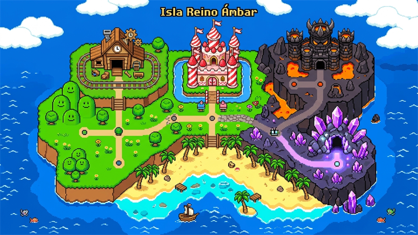

# 🎮 Super Ambar All-Stars — 16-Bit SNES Platformer

<p align="center">
  
</p>

<p align="center">
  <b>Un videojuego de plataformas 2D retro inspirado en los clásicos de 16-bits de Super Nintendo (SNES).</b><br>
  Construido con JavaScript puro (ES6+) y HTML5 Canvas, sin motores externos.
</p>

<p align="center">
  <a href="https://super-ambar-all-stars.vercel.app" target="_blank">
    
  </a>
  
  
  
</p>

---

## 🕹️ Jugar Ahora
👉 **[Acceder al juego en vivo (Vercel)](https://super-ambar-all-stars.vercel.app)**

---

## ✨ Características Principales

* **Motor de Física 2D Propietario:** Sistema de colisiones por bounding-box, aceleración horizontal, fricción, gravedad e inercia ajustada al pixel.
* **Múltiples Mundos y Niveles:** Mapas de mundo (*World 1* y *World 2*), castillos, cavernas, ciudadelas heladas y enfrentamientos contra Bosses.
* **Transformaciones & Power-Ups:** Mecánicas de vestuarios y habilidades especiales (Skate, Bicicleta, Vuelo, Sirena, Jeans y Hoodie).
* **Motor de Sonido 16-Bit:** Efectos de salto, recolección de items y música adaptativa generados mediante la **Web Audio API**.
* **Controles Duales (Desktop & Mobile):**
  * **PC:** Teclado (Flechas / WASD para mover, Espacio para saltar).
  * **Celulares:** Interfaz táctil dedicada (`Super_Ambar_Movil.html`) y manifest PWA para instalarlo como aplicación en el celular.

---

## 🛠️ Stack Tecnológico

| Capa | Tecnología |
| :--- | :--- |
| **Lenguaje Core** | JavaScript (ES6+ Vanilla) |
| **Renderizado** | HTML5 Canvas API |
| **Audio** | Web Audio API / Sintetizador de tonos retro |
| **Tipografía & UI** | Google Fonts (*Press Start 2P*, *Titan One*) |
| **Despliegue** | Vercel (CI/CD automático desde GitHub) |

---

## 🚀 Ejecución en Local

Si deseas correr o inspeccionar el juego localmente:

1. **Clona el repositorio:**
   ```bash
   git clone https://github.com/rdbergeruser-stack/super-ambar-all-stars.git
   cd super-ambar-all-stars
   ```

2. **Abre el juego:**
   * Simplemente haz doble clic en `index.html` para abrirlo en tu navegador.
   * O utiliza la extensión **Live Server** en Visual Studio Code.

---

## 👤 Autor

**Rodrigo Damián Berger**
* **LinkedIn:** [linkedin.com/in/rodrigo-berger](https://www.linkedin.com/in/rodrigo-berger/)
* **GitHub:** [@rdbergeruser-stack](https://github.com/rdbergeruser-stack)
